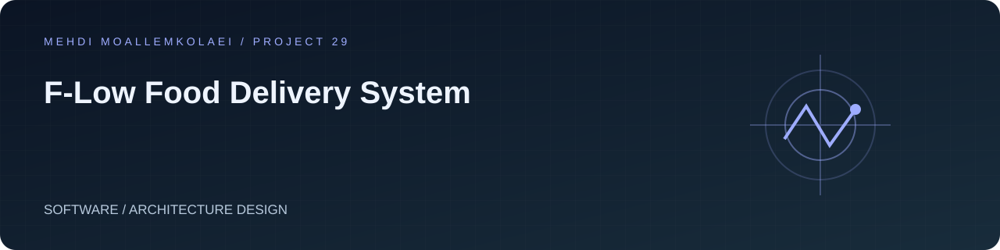

# F-Low Food Delivery System

**Describe a food-delivery system through use cases and a 4+1 architecture design.**

Software architecture · 4+1 views · Use cases

[Overview](#overview) · [Design](portfolio/DESIGN.md) · [Setup](portfolio/SETUP.md) · [Validation](portfolio/VALIDATION.md) · [Evidence](portfolio/EVIDENCE.md)

   

<strong>Architecture design</strong> · <a href="https://ace-alch.github.io/">Engineering portfolio</a>

## Overview

| Item | Record |
| :-- | :-- |
| Project type | Architecture design |
| Field | Software |
| Material in this package | Documentation package; original source not included |
| Documentation review | 17 November 2026 |

## Scope

Describe a food-delivery system through use cases and a 4+1 architecture design.

### Main elements

- Scenarios
- Logical view
- Process view
- Development view
- Physical view

## Start here

1. Read the [design record](portfolio/DESIGN.md) for the system elements and boundaries.
2. Follow the [setup record](portfolio/SETUP.md) for available entry points.
3. Use the [validation plan](portfolio/VALIDATION.md) to record reproducible results.
4. Check the [evidence register](portfolio/EVIDENCE.md) before reusing claims.

## Source status

This package contains project documentation and visual assets. Original code, CAD, data and test records have not been added. The setup record lists the files needed for a reproducible release.

## Next work

- [ ] Architecture report
- [ ] Stakeholders and quality requirements
- [ ] Diagram sources
- [ ] Decision records

## Credits and reuse

Project record: Mehdi Moallemkolaei. Specific third-party and course contributions must retain their original notices.

Existing license terms remain in effect. This package does not grant a new license over source code, course material, models or datasets. See [reuse and contribution notes](portfolio/CONTRIBUTIONS.md).
